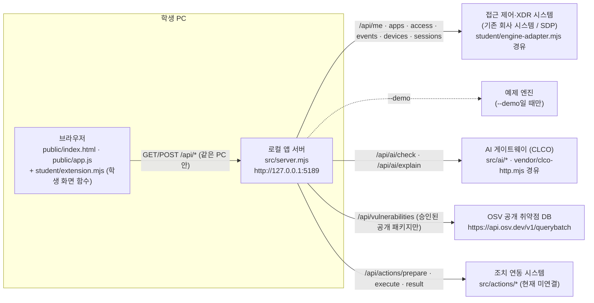

# 케셰브 학생 실행 설명서와 시스템 구성도

이 문서는 학생(지은)이 작성한 문서입니다. 다른 사람이 이 프로젝트를 받아 **어느 폴더에서, 어떤 명령으로** 케셰브를 켜고 끄는지, 그리고 화면 뒤에서 무엇이 어디로 연결되는지 확인할 수 있게 정리했습니다. 제공 문서(`docs/` 아래 기존 파일)는 고치지 않았습니다.

- 표시 규칙: **확인함(실제 실행)** = 이 프로젝트를 직접 실행해 본 것, **확인함(모의 입력)** = 학생 함수에 모의 데이터를 넣어 본 것, **코드로 확인** = 실행하지 않고 원문만 읽은 것, **미확인** = 확인하지 못한 것입니다.
- 비밀값(AI 열쇠·토큰·비밀번호·인증서)은 이 문서와 커밋에 넣지 않습니다.

---

## 1. 케셰브가 하는 일

케셰브는 회사 직원이 **자기 자신의** 보안 상태를 확인하는 보안 앱입니다. 회사 전체를 감시하는 관리자 화면이 아닙니다.

| 메뉴 | 보여 주는 것 | 학생 함수 |
|---|---|---|
| 보호 현황 | 로그인 사용자·기기·세션, 알림·빈 화면·오류·도움정보, 앱 안 AI 연결 점검, 설치 패키지와 알려진 취약점(OSV) | `renderIdentity`, `renderStatus`, `renderAiConnection`, `renderVulnerabilities` |
| 업무 앱 | 업무 앱 하나에 대한 접근 판정(허용·거부·추가 확인·확인 불가)과 요청 실패 | `renderDecision` |
| 보안 기록 | 내 접속 기록·저장된 XDR 경보 목록과 상세, AI 사건 설명, 보안 조치 요청 상태 | `renderEvents`, `renderExplanation`, `renderAction` |

---

## 2. 필요한 프로그램과 버전

| 항목 | 값 | 근거 | 확인 상태 |
|---|---|---|---|
| Node.js | **24.19.0** (수업 기준). 실행 도구는 22~24를 허용하고 24.19.0이 아니면 참고 문구를 출력 | `package.json`의 `engines.node`, `tools/start-alekov.ps1` 88~93줄 | 학생 PC(Windows) 버전: **미확인**. 클라우드 리눅스 작업 공간에서 **v22.22.0**으로 `node src/server.mjs`·`--demo` 실행을 **확인함(실제 실행)**. 이때 Node 22는 SQLite 실험 기능 경고를 한 줄 출력했지만 서버는 정상 응답 |
| 외부 npm 패키지 | 없음 (`dependencies` 없음, `package-lock.json` 없음) | `package.json` | 코드로 확인 |
| Windows PowerShell | 실행 도구 `tools\start-alekov.ps1` 실행용 | 제공 문서 `docs/STUDENT_LAUNCH_GUIDE.md` | **미확인** (작성 환경이 리눅스라 PowerShell 실행 도구는 직접 돌려 보지 못함) |
| Git | 커밋·제출용 | — | 사용함 |
| 브라우저 | PC 브라우저(창 너비 1280px 이상 권장) | 13단계 안내 | Chromium으로 **확인함(실제 실행)** |

`package.json` 스크립트(원문 그대로):

| 명령 | 실제 내용 | 뜻 |
|---|---|---|
| `npm start` | `node src/server.mjs` | 기본 실행. 기존 회사 시스템에 연결되지 않은 상태(연결 없음)가 정상 |
| `npm run demo` | `node src/server.mjs --demo` | 예제 자료로 화면만 보여 줌. 실제 연결이 아님 |
| `npm run check` | `node --check student/extension.mjs` | 학생 파일 문법만 확인 |

---

## 3. 폴더 구조

Git 저장소의 최상위는 **프로젝트 폴더**이고, 앱은 그 안의 **`on-client` 폴더(앱 폴더)**에 있습니다. 실행은 앱 폴더에서, 커밋은 프로젝트 폴더에서 합니다.

```
<프로젝트 폴더>/                 ← Git 최상위 (커밋·제출 기준)
└─ on-client/                    ← 앱 폴더 (PowerShell을 여는 곳)
   ├─ package.json               ← 스크립트·Node 버전
   ├─ .env.example               ← 비밀 없는 설정 견본
   ├─ .on-starter-manifest.json  ← 제공 파일 목록·해시 (고치지 않음)
   ├─ README.md                  ← 제공 README + 맨 아래 학생 부분
   ├─ tools/start-alekov.ps1     ← 실행 도구 (제공)
   ├─ public/                    ← 브라우저 화면 (제공: index.html, app.js, ai-connect.mjs, vulnerabilities-view.mjs, style.css)
   ├─ src/                       ← 로컬 앱 서버 (제공: server.mjs, engine.mjs, ai/, actions/, connection/, engine/, vulnerabilities/)
   ├─ student/
   │  ├─ extension.mjs           ← 학생 작성 (13~20단계 화면 함수 8개)
   │  └─ engine-adapter.mjs      ← 기존 시스템 연결 어댑터 (제공 견본, 고치지 않음)
   ├─ vendor/clco-http.mjs       ← AI 게이트 통신 모듈 (제공)
   └─ docs/
      ├─ STUDENT_RUNBOOK.md      ← 이 문서 (학생 작성)
      └─ (그 밖의 .md·.json)      ← 제공 문서
```

---

## 4. 실행하기

### 4-1. PowerShell을 여는 위치

1. 파일 탐색기에서 `<프로젝트 폴더>\on-client` 폴더를 엽니다.
2. 탐색기 주소 표시줄에 `powershell`을 입력하고 Enter를 누릅니다. 그 폴더에서 PowerShell 창이 열립니다.

### 4-2. 실행 명령 (셋 중 하나)

| 방법 | 명령 (앱 폴더에서) | 정상 시작 신호 | 확인 상태 |
|---|---|---|---|
| 실행 도구 (권장) | `powershell -NoProfile -ExecutionPolicy Bypass -File .\tools\start-alekov.ps1` | `케셰브가 켜졌습니다. 브라우저에서 http://127.0.0.1:5189/ 을 여세요.` 와 `서버가 응답한 것만 확인했습니다. AI 연결 상태는 화면에서 따로 확인해 주세요.` 두 줄, 이어서 `끄려면 이 창에서 Ctrl+C 를 누르세요.` | 문구는 실행 도구 원문 133·134·139줄로 **코드로 확인**. 실제 PowerShell 실행은 **미확인** |
| npm 기본 실행 | `npm start` | `케셰브 연결 확인: http://127.0.0.1:5189` | `node src/server.mjs`로 **확인함(실제 실행)** |
| 예제 화면 | `npm run demo` | `케셰브 예제: http://127.0.0.1:5189` | `node src/server.mjs --demo`로 **확인함(실제 실행)** |

- 실행 도구 옵션(원문의 `param`): `-Port 5190`(다른 포트), `-Demo`(예제), `-Background`(창 없이 실행), `-NativeHostConfig "<절대 경로>"`·`-SdpHostConfig "<절대 경로>"`(담당자가 설정 파일을 안내한 경우에만).
- `-ExecutionPolicy Bypass`는 이번 한 번의 실행에만 적용되며 PC 설정을 바꾸지 않습니다.

### 4-3. 브라우저 주소와 정상 화면

- 주소: **http://127.0.0.1:5189/** (포트를 바꿨다면 그 번호)
- 정상 화면: 위쪽 상태 표시, 메뉴 세 개(「보호 현황」「업무 앱」「보안 기록」)
- 기본 실행(`npm start`)에서 확인한 실제 화면(**확인함(실제 실행)**):
  - 위쪽 상태 표시: `연결 없음`
  - 학생 신원 칸: `연결 실패: 기존 서버·에이전트의 연결을 확인할 수 없습니다. 연결 어댑터를 먼저 확인하세요. (ENGINE_NOT_CONNECTED)`
  - 이 상태는 **오류가 아니라 정상**입니다. 기본 실행은 기존 회사 시스템에 연결하지 않기 때문입니다.

### 4-4. 종료와 다시 실행

| 할 일 | 방법 |
|---|---|
| 종료 | 앱을 켠 PowerShell 창에서 `Ctrl+C`. 브라우저 주소가 더 이상 열리지 않으면 꺼진 것입니다 |
| `-Background`로 켠 경우 종료 | 화면에 나온 「프로세스 번호」의 node를 작업 관리자에서 종료 |
| 다시 실행 | 같은 앱 폴더에서 4-2의 명령을 다시 실행. 실행·종료는 내 파일을 바꾸지 않습니다 |
| 화면만 새로 받기 | 앱 위쪽 「다시 불러오기」 버튼. 자동으로 다시 요청하지 않습니다 |

### 4-5. 설정값 (비밀 없음)

`.env.example`에 있는 이름과 서버 코드가 실제로 읽는 환경 변수입니다. **서버 코드는 `.env` 파일을 스스로 읽지 않고** 실행할 때의 환경 변수(`process.env`)만 읽습니다(`src/server.mjs` 726~738줄, **코드로 확인**).

| 이름 | 견본 값 | 뜻 |
|---|---|---|
| `ON_PORT` | `5189` | 서버 포트 |
| `ON_ENGINE_ADAPTER` | `./student/engine-adapter.mjs` | 기존 시스템 연결 어댑터 경로 |
| `ON_AI_MODEL` | `aleph/auto` | 앱 안 AI 모델 이름(허용 여부는 원격 앱 정책이 결정) |
| `ON_PROJECT_DIRECTORY` | (비어 있음) | 패키지 조회 대상 프로젝트. 비어 있으면 `not_configured` |
| `ON_APPROVED_PUBLIC_PACKAGES` | `[]` | 공개 조회를 승인받은 패키지 목록. 비어 있으면 외부 조회를 하지 않음 |

AI 게이트 주소·열쇠는 학생이 입력하지 않습니다. 담당자가 준비하며, 이 문서와 커밋에도 적지 않습니다.

---

## 5. 시스템 구성도

### 5-1. Mermaid



### 5-2. 같은 내용을 글로

```
[브라우저]  public/index.html + public/app.js  ──(화면 칸에 그리기)──>  student/extension.mjs
     │  모든 자료 요청은 같은 PC의 로컬 앱 서버로만 갑니다 (학생 함수는 서버를 직접 부르지 않음)
     ▼
[로컬 앱 서버] src/server.mjs  (127.0.0.1:5189)
     ├─ 로그인·업무 앱·접근 판정·기록·기기·세션 ──> [접근 제어·XDR 시스템]  (student/engine-adapter.mjs 경유)
     │        · 기본 실행: 연결 없음(ENGINE_NOT_CONNECTED)   · --demo: 예제 엔진
     ├─ AI 연결 점검·사건 설명 ──────────────────────> [AI 게이트웨이(CLCO)]  (src/ai/*, vendor/clco-http.mjs)
     ├─ 설치 패키지 조회 ──────────────────────────> [OSV] https://api.osv.dev/v1/querybatch (승인 목록이 비면 조회 안 함)
     └─ 보안 조치 준비·집행·결과 재조회 ────────────> [조치 연동 시스템]  (src/actions/*, 현재 미연결)
```

### 5-3. 화면 → 서버 경로 → 학생 함수

| 화면 칸(요소 ID) | 메뉴 | 서버 경로 (`public/app.js`·`src/server.mjs` 원문) | 학생 함수 |
|---|---|---|---|
| `#student-identity` | 보호 현황 | `GET /api/me`, `/api/devices`, `/api/sessions` | `renderIdentity` |
| `#student-status` | 보호 현황 | 위 자료 + `GET /api/diagnostics`(제공 「도움정보 불러오기」를 누를 때만) | `renderStatus` |
| `#student-ai-connection` | 보호 현황 | `POST /api/ai/check` (+ AI 연결 절차 `/api/ai/connect/*`, 계정 연결 `/api/native-login/*`) | `renderAiConnection` |
| `#student-vulnerabilities` | 보호 현황 | `GET /api/vulnerabilities` | `renderVulnerabilities` |
| `#student-decision` | 업무 앱 | `GET /api/apps`, `POST /api/access` | `renderDecision` |
| `#student-events` | 보안 기록 | `GET /api/events` | `renderEvents` |
| `#student-explanation` | 보안 기록 | `POST /api/ai/explain` | `renderExplanation` |
| `#student-action` | 보안 기록 | `POST /api/actions/prepare`·`/execute`·`/result` | `renderAction` |

---

## 6. 제공 코드와 학생 작성 부분의 경계

| 구분 | 파일 | 누가 | 학생이 고쳤나 |
|---|---|---|---|
| 화면 틀·요청·검사·버튼 | `public/index.html`, `public/app.js`, `public/ai-connect.mjs`, `public/vulnerabilities-view.mjs`, `public/style.css` | 제공 | 아니요 |
| 로컬 앱 서버·AI·조치·연결·패키지 조회 | `src/` 전체, `vendor/clco-http.mjs` | 제공 | 아니요 |
| 실행 도구 | `tools/*.ps1` | 제공 | 아니요 |
| 연결 어댑터 견본 | `student/engine-adapter.mjs` | 제공 | 아니요 |
| **학생 화면 함수** | **`student/extension.mjs`** | **학생** | **예 (13~20단계)** |
| **학생 문서** | **`docs/STUDENT_RUNBOOK.md`, `README.md` 맨 아래 「학생 부분」** | **학생** | **예 (21단계)** |

학생 함수의 공통 규칙(원문 `student/extension.mjs`):
- `createStudentView()`가 함수 8개를 돌려줍니다. 제공 화면이 `renderStudent(kind)`로 입력을 넘기면, 학생 함수는 **DOM 요소 하나**를 돌려줍니다.
- 화면은 `document.createElement`와 `textContent`로만 그립니다(HTML 문자열을 쓰지 않음).
- 학생 함수는 서버를 직접 호출하지 않고, 자동 재시도·타이머·브라우저 저장소를 쓰지 않습니다. 실행 버튼도 만들지 않습니다(16단계의 「`<action>` 미지원」은 누를 수 없는 버튼). 예외는 16단계 「도움정보 복사」 버튼 하나이며, 정해진 여섯 값만 클립보드에 복사합니다.
- 입력이 올 때마다 새 요소를 만들기 때문에, 다시 불러오거나 실패하면 이전 값이 남지 않습니다.

---

## 7. 학생 구현 함수와 확인한 기능

| 단계 | 함수 | 하는 일 | 확인 상태 |
|---|---|---|---|
| 13 | `renderIdentity` | 사용자·기기·세션의 이름·ID·상태. 보안 기준 미충족·만료·철회됨·확인 불가에 「⚠ 주의」 표시. 실패하면 「연결 실패」(계약 불일치는 「확인 불가」)와 함께 옛 사용자 값을 지움 | 예제 모드·기본 실행 **확인함(실제 실행)**, 상태별 **확인함(모의 입력)** |
| 14 | `renderDecision` | 접근 허용·거부·추가 인증 또는 확인 필요·판정 확인 불가와 원래 값, 이유·시각. 요청 실패는 거부가 아니라고 표시 | 예제 3개 앱 **확인함(실제 실행)**, unknown·실패 **확인함(모의 입력)** |
| 15 | `renderEvents` | 최신순 목록, 「기록 종류」「업무 앱」「접속 상태」 필터, 「`<id>` 상세」(근거·규칙·세 상태). 빈 목록과 조회 실패를 다르게 표시 | 예제 1건 **확인함(실제 실행)**, 여러 건 필터 **확인함(모의 입력)** |
| 16 | `renderStatus` (+15단계 상세) | 기기·세션·도움정보의 불러오는 중/빈 목록/실패/시간 초과, 알림 목록, 「도움정보 복사」, 「`<action>` 미지원」 비활성 버튼 | 복사 내용·자동 재요청 없음 **확인함(실제 실행)**, 미지원 버튼 **확인함(모의 입력)** |
| 17 | `renderAiConnection` | 점검 전·중·test·verified·오류 원인별 안내(권한 준비 중·인증·접근 제한·한도·이용 시간·요청 제한·시간 초과·취소·모델 없음). 「사건 설명은 아직 실행하지 않았습니다」 | 예제 모드 「권한 준비 중」 **확인함(실제 실행)**, 나머지 **확인함(모의 입력)** |
| 18 | `renderExplanation` | 근거 ID를 고른 기록의 근거와 대조, 근거 글·규칙·확인 불가 상태·제안(미실행). 근거 불일치·「이미 실행」 응답은 쓰지 않음 | 예제 모드 실패 표시 **확인함(실제 실행)**, 성공·불일치 **확인함(모의 입력)** |
| 19 | `renderAction` | 제안·준비·전달(executing)·접수(pending, ACK)·효과 확인(succeeded + `effectApplied: true`일 때만)·거절·실패·결과 불명·기한 지남·오류 구분 | 예제 모드 「아직 미실행」 **확인함(실제 실행)**, 11개 상태 **확인함(모의 입력)** |
| 20 | `renderVulnerabilities` | 조회 전·중·실패, 전체 상태 5종, lock 정보, 패키지별 정확한 설치 버전·status·source·checkedAt·취약점 id·modified. 일부 조회 시 받은 ID 유지 | 예제 모드 `not_configured` **확인함(실제 실행)**, 나머지 **확인함(모의 입력)** |

---

## 8. 장애 상황별 확인 순서와 복구

| 증상(화면·창 문구) | 어디서 나오나 | 확인할 것 | 복구 |
|---|---|---|---|
| `Node.js 가 없습니다` / `지금 Node.js 는 vXX 입니다` | 실행 도구 88·92줄 | `node --version` | Node.js 24.19.0 설치 후 **새** PowerShell 창에서 다시 실행 |
| `포트 5189 를 다른 프로그램이 쓰고 있습니다` | 실행 도구 101줄 | 이미 켜 둔 케셰브 창이 있는지 | 그 프로그램은 그대로 두고 `-Port 5190`으로 실행, 브라우저도 `:5190` |
| `앱 폴더가 아닙니다` / `시작 틀 폴더가 아닙니다` | 실행 도구 40·45줄 | PowerShell 위치가 `on-client`인지 | `on-client` 폴더에서 다시 실행 |
| `앱 서버가 20 초 안에 뜨지 않았습니다` | 실행 도구 131줄 | 창의 메시지 전체 | 메시지와 도움정보를 강사에게 보여 줌 |
| `연결 없음` + `ENGINE_NOT_CONNECTED` | 서버 → 학생 신원·상태·기록 칸 | 기본 실행인지, 담당자 연결 설정이 있는지 | 기본 실행에서는 정상. 실제 연결은 담당자 안내(`-SdpHostConfig`)가 있을 때만 |
| `연결 실패: 로컬 서버에 연결할 수 없습니다. (NETWORK_ERROR)` | 서버가 꺼졌을 때 학생 칸 | PowerShell 창이 아직 켜져 있는지 | 4-2로 다시 켠 뒤 「다시 불러오기」 (13·16단계에서 **확인함(실제 실행)**) |
| `시간 초과` (`TIMEOUT`) | 학생 상태·AI·패키지 칸 | 서버 창의 오류, 네트워크 | 잠시 뒤 버튼을 직접 다시 누름 (자동 재시도 없음) |
| `확인 불가` (`CONTRACT_MISMATCH`, `ENGINE_RESULT_UNVERIFIED`) | 학생 신원·판정·기록 칸 | 응답 형식이 계약과 다름 | 정상으로 보지 않음. 「다시 불러오기」, 계속되면 도움정보를 강사에게 |
| `권한 준비 중 또는 확인 불가` (`ON_AI_PROVISIONING_PENDING`) | 학생 AI 연결·AI 설명 칸 | 계정 연결·AI 앱 승인을 했는지 | 학생 잘못이 아님. 담당자에게 계정 연결과 앱 권한 확인 요청 |
| `근거 부족` / `근거 불일치 또는 응답 형식 확인 불가` (`ON_AI_INVALID_INPUT` / `ON_AI_INVALID_OUTPUT`) | 학생 AI 설명 칸 | 고른 기록에 근거·규칙이 있는지 | 기록은 그대로. 필요하면 설명을 직접 다시 요청 |
| `조회 준비 미완료(not_configured)` / `아직 조회 안 함(not_checked)` | 학생 패키지 칸 | `ON_PROJECT_DIRECTORY`·승인 목록 | 담당자가 준비. 학생이 임의로 바꾸지 않음. 「취약점 없음」이 아님 |
| `결과 불명(unknown)` (`ACTION_TIMEOUT` 등) | 학생 조치 칸 | 이미 서버에 전달됐는지 | 다시 집행하지 말고 「원천 결과만 재조회」 |
| `확인 기한 지남(expired)` | 학생 조치 칸 | — | 현재 사건에서 조치를 다시 준비 |

더 자세한 오류 코드는 제공 문서 `docs/CONNECTION_TROUBLESHOOT.md`, 실행 도구 메시지는 `docs/STUDENT_LAUNCH_GUIDE.md` 4장에 있습니다.

---

## 9. 지원하지 않는 것과 확인하지 않은 것

| 항목 | 상태 |
|---|---|
| Windows PowerShell에서 `tools\start-alekov.ps1` 실행 | **미확인** (작성 환경이 리눅스) |
| Node.js 24.19.0에서 실행 | **미확인** (v22.22.0에서만 실행해 봄) |
| 실제 회사 시스템(SDP) 연결 상태의 화면 | **미확인** (담당자 설정 필요, 기본 실행은 연결 없음) |
| 계정 연결 → AI 앱 승인 → 「현재 API 연결 점검」 → 실제 AI 사건 설명 성공 | **미확인** (담당자의 앱 권한 발급 필요. 17단계 판정에서도 `ai_model_called`는 확인 보류) |
| 실제 보안 조치 집행·효과 관측 | **미확인 / 지원 안 됨** (조치 연동 시스템이 아직 연결되지 않음, 현재 기록의 `supportedActions`가 비어 있음) |
| 실제 패키지 표와 `package-lock.json` 버전 대조 | **미확인** (조회 대상 프로젝트·승인 목록이 비어 있어 `not_configured`) |
| OSV 결과가 없을 때 「안전함」 | **보장하지 않음** (알려진 취약점 DB 조회 결과일 뿐) |
| AI 설명·제안으로 보안 조치 실행 | **하지 않음** (설명은 참고 정보, 조치는 사람 확인 후 제공 화면 버튼으로만) |
